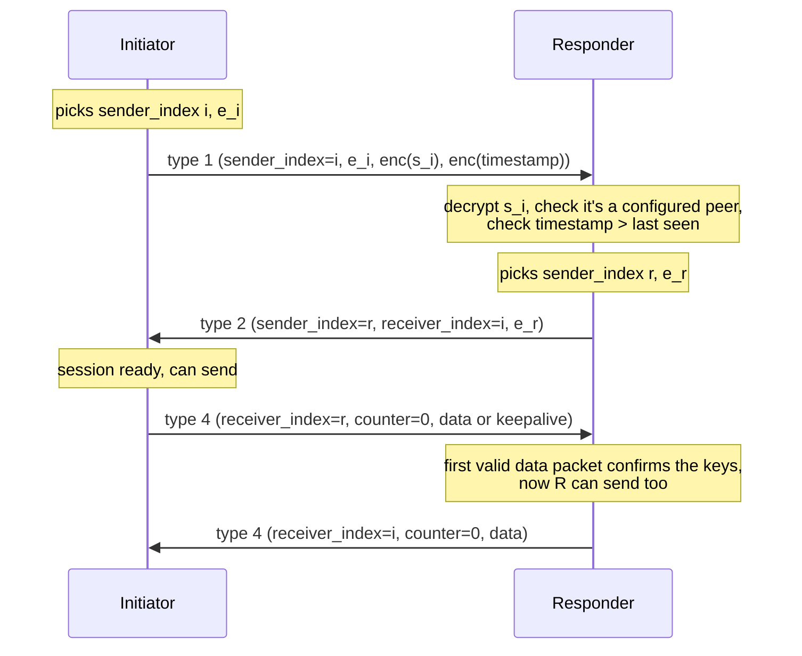

# Wire protocol, version 1

Layer 3 tunnel over UDP. Peers authenticate each other with static Curve25519
keys using the Noise `IK` handshake, then exchange encrypted IP packets. The
design follows WireGuard closely (https://www.wireguard.com/papers/wireguard.pdf)
and the differences are listed at the end. It is not wire compatible with
WireGuard.

All integers are little-endian, except the TAI64N timestamp in the handshake.
That one is big-endian by definition, so two timestamps compare correctly as
raw bytes. All sizes are in bytes.

## Goals and non-goals

The protocol should:

- reveal nothing to an observer except packet sizes, timing, and the outer IP
  and UDP headers
- never answer a packet it can't authenticate, so a scan gets silence and
  nobody can use us as a traffic amplifier
- survive packet loss and reordering, since UDP gives neither delivery nor
  ordering guarantees
- keep enough state per peer to route an incoming datagram to its session in
  O(1), without trial-decrypting against every key

It won't negotiate anything. Version 1 is one fixed cipher suite, and a new
suite means a new protocol version.

## Cryptography

| Purpose | Choice |
|---|---|
| Handshake | `Noise_IK_25519_ChaChaPoly_BLAKE2s` via `snow` |
| Prologue | ASCII `JackFurton/vpn v1` (17 bytes) |
| Transport AEAD | ChaCha20-Poly1305, keys from the completed handshake |
| AEAD nonce | 4 zero bytes followed by the 64-bit packet counter, LE |

The prologue gets mixed into the handshake hash. So a peer running a different
protocol version, or a different protocol entirely, fails the handshake
instead of ending up with a half-working session.

`IK` means the initiator already knows the responder's static public key (I
for immediate: the initiator sends its own static key in the first message, K
for known: it already knows the responder's). The initiator's static key is
encrypted in transit, so an observer can't tell which client is connecting.

## Message types

Every message starts with a 4-byte header: a type byte, then 3 reserved bytes
that must be zero. A 32-bit header keeps the following fields aligned.

| Type | Message | Size |
|---|---|---|
| 1 | Handshake initiation | 148 |
| 2 | Handshake response | 92 |
| 3 | Cookie reply | 64, reserved, defined by #12 |
| 4 | Transport data | 32 + padded payload |

Drop a datagram if its type is unknown, its reserved bytes aren't zero, or
its length doesn't match the type. Data messages must be at least 32 bytes.
Don't require the payload to be a multiple of 16: a packet padded up to the
MTU can stop short of one (1420 isn't a multiple of 16).

### Handshake initiation (type 1)

```
 0                   1                   2                   3
 0 1 2 3 4 5 6 7 8 9 0 1 2 3 4 5 6 7 8 9 0 1 2 3 4 5 6 7 8 9 0 1
+-+-+-+-+-+-+-+-+-+-+-+-+-+-+-+-+-+-+-+-+-+-+-+-+-+-+-+-+-+-+-+-+
|   type = 1    |                reserved (0)                   |
+-+-+-+-+-+-+-+-+-+-+-+-+-+-+-+-+-+-+-+-+-+-+-+-+-+-+-+-+-+-+-+-+
|                         sender_index                          |
+-+-+-+-+-+-+-+-+-+-+-+-+-+-+-+-+-+-+-+-+-+-+-+-+-+-+-+-+-+-+-+-+
|                                                               |
~               noise message 1 (108 bytes)                     ~
|                                                               |
+-+-+-+-+-+-+-+-+-+-+-+-+-+-+-+-+-+-+-+-+-+-+-+-+-+-+-+-+-+-+-+-+
|                          mac1 (16)                            |
+-+-+-+-+-+-+-+-+-+-+-+-+-+-+-+-+-+-+-+-+-+-+-+-+-+-+-+-+-+-+-+-+
|                          mac2 (16)                            |
+-+-+-+-+-+-+-+-+-+-+-+-+-+-+-+-+-+-+-+-+-+-+-+-+-+-+-+-+-+-+-+-+
```

The 108-byte Noise message breaks down as follows:

- the initiator's ephemeral public key (32)
- its static public key, encrypted (32 plus a 16-byte tag)
- an encrypted 12-byte TAI64N timestamp (12 plus a 16-byte tag)

`sender_index` is a random 32-bit value the initiator picks for this
handshake. The responder puts it in every packet it sends back, so the
initiator can find the session without looking at keys.

The timestamp blocks handshake replay. If an attacker captures an initiation
and resends it, the responder sees a timestamp that isn't newer than the last
one it accepted from that peer, and drops it. Without that check the attacker
could make the responder throw away a live session. Timestamps only have to
increase per peer, so clocks don't need to be in sync.

`mac1` and `mac2` are reserved for DoS protection (#12). Until that lands,
senders write zeros and receivers ignore both fields. They're in the layout
from version 1 so adding them later doesn't change any sizes.

### Handshake response (type 2)

```
 0                   1                   2                   3
 0 1 2 3 4 5 6 7 8 9 0 1 2 3 4 5 6 7 8 9 0 1 2 3 4 5 6 7 8 9 0 1
+-+-+-+-+-+-+-+-+-+-+-+-+-+-+-+-+-+-+-+-+-+-+-+-+-+-+-+-+-+-+-+-+
|   type = 2    |                reserved (0)                   |
+-+-+-+-+-+-+-+-+-+-+-+-+-+-+-+-+-+-+-+-+-+-+-+-+-+-+-+-+-+-+-+-+
|                         sender_index                          |
+-+-+-+-+-+-+-+-+-+-+-+-+-+-+-+-+-+-+-+-+-+-+-+-+-+-+-+-+-+-+-+-+
|                        receiver_index                         |
+-+-+-+-+-+-+-+-+-+-+-+-+-+-+-+-+-+-+-+-+-+-+-+-+-+-+-+-+-+-+-+-+
|                                                               |
~               noise message 2 (48 bytes)                      ~
|                                                               |
+-+-+-+-+-+-+-+-+-+-+-+-+-+-+-+-+-+-+-+-+-+-+-+-+-+-+-+-+-+-+-+-+
|                          mac1 (16)                            |
+-+-+-+-+-+-+-+-+-+-+-+-+-+-+-+-+-+-+-+-+-+-+-+-+-+-+-+-+-+-+-+-+
|                          mac2 (16)                            |
+-+-+-+-+-+-+-+-+-+-+-+-+-+-+-+-+-+-+-+-+-+-+-+-+-+-+-+-+-+-+-+-+
```

`sender_index` is the responder's own random index. `receiver_index` echoes
the initiator's `sender_index`. The Noise message is the responder's
ephemeral public key (32) plus the tag over an empty payload (16).

The response (92 bytes) is smaller than the initiation (148), so a forged
source address can't get us to send a victim more bytes than the attacker
sent us.

### Transport data (type 4)

```
 0                   1                   2                   3
 0 1 2 3 4 5 6 7 8 9 0 1 2 3 4 5 6 7 8 9 0 1 2 3 4 5 6 7 8 9 0 1
+-+-+-+-+-+-+-+-+-+-+-+-+-+-+-+-+-+-+-+-+-+-+-+-+-+-+-+-+-+-+-+-+
|   type = 4    |                reserved (0)                   |
+-+-+-+-+-+-+-+-+-+-+-+-+-+-+-+-+-+-+-+-+-+-+-+-+-+-+-+-+-+-+-+-+
|                        receiver_index                         |
+-+-+-+-+-+-+-+-+-+-+-+-+-+-+-+-+-+-+-+-+-+-+-+-+-+-+-+-+-+-+-+-+
|                                                               |
+                        counter (64 bits)                      +
|                                                               |
+-+-+-+-+-+-+-+-+-+-+-+-+-+-+-+-+-+-+-+-+-+-+-+-+-+-+-+-+-+-+-+-+
|                                                               |
~        encrypted inner IP packet, padded to 16 bytes          ~
|                                                               |
+-+-+-+-+-+-+-+-+-+-+-+-+-+-+-+-+-+-+-+-+-+-+-+-+-+-+-+-+-+-+-+-+
|                     Poly1305 tag (16)                         |
+-+-+-+-+-+-+-+-+-+-+-+-+-+-+-+-+-+-+-+-+-+-+-+-+-+-+-+-+-+-+-+-+
```

`receiver_index` is the index the *recipient* chose during the handshake.
`counter` starts at 0 for each session, goes up by one per packet, and is the
AEAD nonce. It travels in the clear because UDP can lose and reorder packets,
so the receiver can't work out the nonce by counting. Never reuse a counter
under the same key. Reusing a ChaCha20-Poly1305 nonce leaks the XOR of the
two plaintexts and lets an attacker forge messages.

Before encrypting, pad the inner packet with zeros up to a multiple of 16
bytes, but never past the tunnel MTU. The receiver strips the padding using
the inner packet's own length field: IPv4 total length, or IPv6 payload length
plus 40. Drop a decrypted packet that isn't valid IPv4 or IPv6, or whose
length field is larger than the decrypted data.

A data message with an empty payload (32 bytes on the wire) is a keepalive.
It keeps NAT mappings open and confirms the session is alive. Don't write it
to the TUN device.

## Handshake flow



Rules:

1. The responder decrypts the initiator's static key, then looks it up in its
   configured peer list. If the key is unknown, it drops the message silently.
2. The initiator can send data as soon as it has processed the response.
3. The responder doesn't send data until it gets the first valid data packet
   on the new session. Until then it can't know the initiator really finished
   the handshake. If the initiator has nothing queued, it sends a keepalive
   right away so the responder doesn't wait.
4. Indices are random, not sequential, and unique among one peer's live
   sessions. They're lookup keys, not secrets. Don't rely on them for security.
5. A new handshake doesn't kill the current session. Keep the previous session
   until the new one is confirmed, so packets already in flight still decrypt
   (#11).

## Receiving a data packet

The order of these checks matters:

1. Check the length and header, as described in Message types.
2. Look up the session by `receiver_index`. If there's no match, drop it.
3. If `counter` is clearly too old for the replay window, drop it. This step
   is just a cheap early exit.
4. Decrypt and authenticate with `counter` as the nonce. If that fails, drop
   it.
5. Now mark `counter` as seen in the replay window (#5). If it was already
   seen, drop it.
6. Make sure the inner packet's source address is in this peer's allowed IPs
   (#17), then write it to the TUN device.

The replay window only gets updated *after* authentication succeeds. Otherwise
a forged packet with a huge counter would slide the window forward, and every
real packet after it would get rejected as too old.

## MTU

The tunnel adds 32 bytes to every inner packet (16 header plus 16 tag), and
the outer IP and UDP headers add more on top:

| Outer path | Overhead | Tunnel MTU on a 1500-byte link |
|---|---|---|
| IPv4 | 20 IP + 8 UDP + 32 = 60 | 1440 |
| IPv6 | 40 IP + 8 UDP + 32 = 80 | 1420 |

The default tunnel MTU is 1420, which fits either outer IP version. Padding
never takes a packet past the tunnel MTU.

## Session lifecycle

These constants come from WireGuard:

| Constant | Value |
|---|---|
| `REKEY_AFTER_MESSAGES` | 2^60 |
| `REJECT_AFTER_MESSAGES` | 2^64 - 2^13 - 1 |
| `REKEY_AFTER_TIME` | 120 s |
| `REJECT_AFTER_TIME` | 180 s |
| `REKEY_ATTEMPT_TIME` | 90 s |
| `REKEY_TIMEOUT` | 5 s |
| `KEEPALIVE_TIMEOUT` | 10 s |

Each peer keeps up to three sessions:

- **current**: the one we send on.
- **previous**: the session current replaced. It's receive-only, so packets the
  peer sent before it switched still decrypt.
- **next**: a session we accepted as responder. It becomes current when the
  first data packet arrives on it.

The rules:

1. **Rekey by age.** When the side that started the current session sends a
   packet and the session is at least `REKEY_AFTER_TIME` old, it sends that
   packet and then starts a new handshake. Only the initiator does this, so
   the two sides don't both start handshakes at the same moment.
2. **Rekey by count.** Either side starts a new handshake after sending
   `REKEY_AFTER_MESSAGES` on one session.
3. **Rekey on receive.** If the initiator receives data on a session at least
   `REJECT_AFTER_TIME - KEEPALIVE_TIMEOUT - REKEY_TIMEOUT` (165 s) old, it
   rekeys. That way, traffic flowing only from the responder still gets a new
   session before the old one expires.
4. **Expiry.** Never send or accept on a session older than
   `REJECT_AFTER_TIME`. Packets for an expired session get queued and a
   handshake starts.
5. **Retry.** Resend an unanswered initiation every `REKEY_TIMEOUT`. After
   `REKEY_ATTEMPT_TIME`, give up and drop the queued packets.
6. **Passive keepalive.** After receiving data, if we've sent nothing within
   `KEEPALIVE_TIMEOUT`, send a keepalive. This tells the peer we're still here.
7. **Dead peer.** After sending data, if we've heard nothing within
   `KEEPALIVE_TIMEOUT + REKEY_TIMEOUT` (15 s), start a new handshake. A live
   peer's passive keepalive always arrives before this fires. So when it does
   fire, the peer has most likely restarted and forgotten the session.
8. **Persistent keepalive** (optional, per peer). Send a keepalive whenever
   nothing has been sent for the configured interval, and bring the session
   up at startup without waiting for traffic. This holds NAT mappings open,
   so the far side can reach a peer that's behind NAT.

## Differences from WireGuard

- The Noise pattern is plain `IK`, not `IKpsk2`. An optional pre-shared key
  (for post-quantum hedging) could come later as version 2.
- The handshake goes through `snow` rather than hand-built HKDF chaining. The
  prologue is different, so the two protocols can't talk to each other.
- Message types 1 to 4 and their layouts mirror WireGuard on purpose, but
  that's for familiarity, not compatibility. Nothing promises they'll stay
  aligned.
- mac1, mac2, and the cookie reply are defined in #12, not here.
